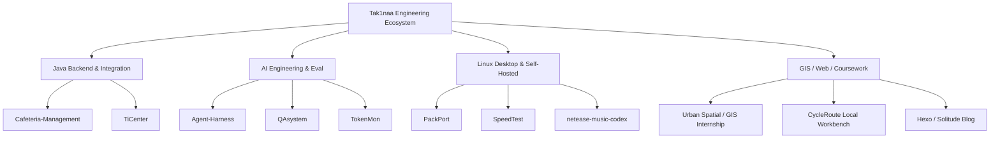
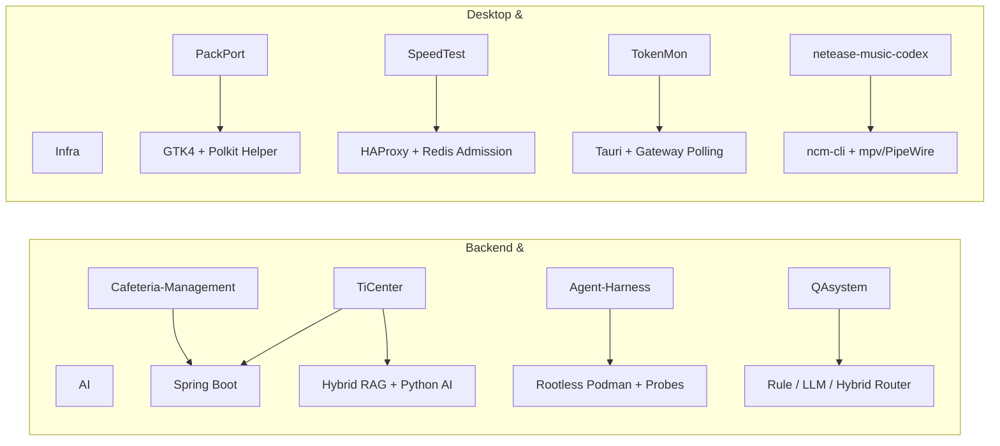

<div align="center">
  <strong>R&amp;D Edition:</strong>
  <a href="./README.md">Main EN</a>
  ·
  <a href="./README.zh-CN.md">Main ZH</a>
  ·
  <strong>R&amp;D EN (current)</strong>
  ·
  <a href="./README.rnd.zh-CN.md">R&amp;D ZH</a>
</div>

<br>

<div align="center">
  <h1>
    Li<sup>3+</sup> · Tak1naa
  </h1>
  <h3>
    Systems-Minded Java Backend • AI Evaluation &amp; Harness • Linux Tooling
  </h3>
  <p>
    Contract-first services · Isolated agent verification · Practical desktop &amp; self-hosted tools
  </p>
  <p>
    <b>Java</b> • <b>Spring Boot</b> • <b>Python</b> • TypeScript • Rust (Tauri) • C/C++ • Linux • Podman / Docker
  </p>
</div>

---

<div align="center">
  <h2>System Profile</h2>
</div>

```text
••• booting profile...▸
  [ ◇ ] Identity..........▸ Zili Ying (Tak1naa / Takina)
  [ ◇ ] Affiliation.......▸ Beijing Jiaotong University · CS (Railway IT, 2024–2028)
  [ ◇ ] Primary Focus.....▸ Java Backend · AI Evaluation Harnesses · Linux Tooling
  [ ◇ ] Secondary Track...▸ Urban Spatial Data / GIS Engineering (Independent Domain)
  [ ◇ ] Runtime Stack.....▸ Linux (Fedora / Debian) · Docker Compose · Rootless Podman
  [ ◇ ] Engineering Rule..▸ Fail-closed boundaries · Verifiable evidence · Honest scope
  [ ✓ ] Blog..............▸ https://tak1na.top/blog
  [ ✓ ] Live SpeedTest....▸ https://tak1na.top/speedtest/
  [ ✓ ] Repositories......▸ https://github.com/Tak1naa?tab=repositories
```

<div align="center">
<a id="top"></a>

<a href="#landscape">Landscape</a> ·
<a href="#experience">Experience</a> ·
<a href="#stack">Tech Stack</a> ·
<a href="#matrix">Project Matrix</a> ·
<a href="#focus">Focus</a> ·
<a href="#telemetry">Telemetry</a>

</div>

---

<a id="landscape"></a>

<div align="center">
  <h2>Engineering Landscape</h2>
  <p><a href="#top">↑ Back to Top</a></p>
</div>

<details open>
<summary><strong>◇ Repository &amp; Domain Map</strong></summary>



| Domain | Core Engineering Question | Representative Work |
| --- | --- | --- |
| **Java Backend & Integration** | How to keep multi-service contracts, caches, queues, and streaming responses reliable? | [Cafeteria-Management](https://github.com/Tak1naa/Cafeteria-Management) · [TiCenter](https://github.com/Tak1naa/TiCenter) |
| **AI & Evaluation Harnesses** | How to verify LLM-generated outputs and retrieval pipelines without conflating engineering checks with model efficacy? | [Agent-Harness](https://github.com/Tak1naa/Agent-Harness) · [QAsystem](https://github.com/Tak1naa/QAsystem) · [TokenMon](https://github.com/Tak1naa/Tokenmon) |
| **Linux & Self-Hosted Tooling** | How to enforce privilege boundaries, rate limits, and clean failure paths in daily tools? | [PackPort](https://github.com/Tak1naa/PackPort) · [SpeedTest](https://github.com/Tak1naa/SpeedTest) · [netease-music-codex](https://github.com/Tak1naa/netease-music-codex) |
| **GIS / Web / Systems Labs** | How to process spatial/track/UI pipelines safely while keeping them distinct from backend resume evidence? | Spatial Data Internship · CycleRoute · [blog](https://github.com/Tak1naa/blog) |

</details>

---

<a id="experience"></a>

<div align="center">
  <h2>Experience &amp; Engineering Practice</h2>
  <p><a href="#top">↑ Back to Top</a></p>
</div>

<details>
<summary><strong>◇ View Detailed Timeline (Internship · Research · Training)</strong></summary>

#### **Beijing Urban Construction Design &amp; Development Group** *(Jul 2026 – Oct 2026, Agreement Period)*
*R&amp;D Intern — Urban Spatial Data &amp; GIS Engineering*

- Cleaned, coordinate-unified, spatially joined, and quality-checked multi-source population grids, maps, and building datasets.
- Contributed to sub-district scale aggregation, satellite imagery processing, and building-attribute fusion under strict confidentiality and desensitization controls.
- *Scope note:* Maintained as an independent GIS/spatial data track separate from Java backend engineering evidence.

---

#### **Undergraduate Innovation Project — Agent-Harness** *(2026)*
*Research &amp; Engineering Prototype*

- Investigates whether Bandit static alerts and AST function context improve LLM-generated Python security tests under identical model, tool, and call-budget constraints.
- Built around restricted `pytest` / `Hypothesis` synthesis, rootless Podman execution, real side-effect probes (path traversal, command injection, SQL injection), CLI + MCP stdio + browser session client.
- Verified 30 synthetic paired test fixtures and completed 216 frozen evaluation trials (A: 62/72, B: 63/72, C: 68/72; 61/69, 62/69, 67/69 excluding budget-exceeded blocks), reporting engineering verification and small-sample descriptive results separately.

---

#### **Software Engineering &amp; Domain Practice** *(2026)*
*Beijing Jiaotong University*

- **Cafeteria-Management:** Spring Boot integration hub connecting a C++ simulation engine (HTTP JSON) and WebSocket UI with MySQL, Redis, RabbitMQ, and DeepSeek/rule-engine fallback.
- **QAsystem:** Railway maintenance QA routing prototype classifying 8 question types and 6 entity categories into structured JSON (`RAG`, `KG`, `CLARIFY`, `OUT_OF_SCOPE`) with offline `pytest` verification.
- **Systems Coursework:** RISC-V SoC debugging &amp; simulation labs (`NEMU`, `Verilator`, `Vivado`).

</details>

---

<a id="stack"></a>

<div align="center">
  <h2>Tech Stack</h2>
  <p><a href="#top">↑ Back to Top</a></p>
</div>

<details>
<summary><strong>◇ Open Detailed Stack</strong></summary>

<p align="center">
  
  
  
  
  
  
  
  
</p>
<p align="center">
  
  
  
  
  
  
  
  
</p>

- **Backend &amp; Contracts:** Java, Spring Boot, HTTP/JSON REST, WebSocket, SSE, Flyway
- **Data &amp; Messaging:** MySQL, PostgreSQL, Redis, RabbitMQ, Qdrant
- **AI &amp; Program Analysis:** Python, Bandit, AST parsing, `pytest`, `Hypothesis`, MCP stdio, BM25 + Vector RRF
- **Desktop &amp; Web UI:** TypeScript, React, GTK4 / Libadwaita, Tauri / Rust, Streamlit, Hexo / Solitude
- **Systems &amp; Hardening:** Linux (Fedora / Debian), Docker Compose, rootless Podman, HAProxy, nginx, Polkit

</details>

---

<a id="matrix"></a>

<div align="center">
  <h2>Project Matrix</h2>
  <p><a href="#top">↑ Back to Top</a></p>
</div>

<details open>
<summary><strong>◇ Complete R&amp;D Project Catalog <b>(10)</b></strong></summary>



<table>
  <thead>
    <tr>
      <th>⌁ Project</th>
      <th>⌁ Architecture &amp; Boundary Notes</th>
      <th>⌁ Stack</th>
    </tr>
  </thead>
  <tbody>
    <tr>
      <td><a href="https://github.com/Tak1naa/Cafeteria-Management">Cafeteria-Management</a></td>
      <td>Spring Boot orchestration layer connecting a C++ simulation core (HTTP JSON) and WebSocket client; includes MySQL, Redis, RabbitMQ, and DeepSeek/rule-engine fallback.</td>
      <td><code>Java · Spring Boot · C++ · MySQL · Redis · RabbitMQ</code></td>
    </tr>
    <tr>
      <td><a href="https://github.com/Tak1naa/TiCenter">TiCenter (题枢)</a></td>
      <td>File-first AI question workspace with student/admin portals, selection-scoped context, hybrid BM25 + vector RRF retrieval, and SSE citations. <i>Status: paused snapshot; OCR/Qdrant migration &amp; cross-service acceptance pending.</i></td>
      <td><code>Java · Spring Boot · React · TS · Python · Qdrant</code></td>
    </tr>
    <tr>
      <td><a href="https://github.com/Tak1naa/Agent-Harness">Agent-Harness</a></td>
      <td>Static-guided (Bandit + AST) LLM security test harness running restricted pytest/Hypothesis probes inside rootless Podman with CLI, MCP stdio, and browser session client.</td>
      <td><code>Python · Bandit · AST · pytest · Podman · MCP</code></td>
    </tr>
    <tr>
      <td><a href="https://github.com/Tak1naa/PackPort">PackPort</a></td>
      <td>Fedora GTK4/Libadwaita drag-and-drop installer for RPM, DEB (Alien + DNF check), AppImage, and Flatpak with unprivileged UI and restricted Polkit helper.</td>
      <td><code>Python · GTK4 · Libadwaita · Polkit · DNF</code></td>
    </tr>
    <tr>
      <td><a href="https://github.com/Tak1naa/SpeedTest">SpeedTest</a></td>
      <td>Bilingual LibreSpeed/bg6cq derivative with HAProxy HTTPS, Redis atomic concurrency/rate limits, bounded uploads, no telemetry, and opt-in anonymized leaderboard.</td>
      <td><code>PHP · Redis · HAProxy · Docker Compose · JS</code></td>
    </tr>
    <tr>
      <td><a href="https://github.com/Tak1naa/Tokenmon">TokenMon</a></td>
      <td>Tauri/Rust desktop-pet LLM gateway monitor (LiteLLM, OpenRouter, DeepSeek, custom JSON) + Python diagnostic CLI; read-only polling triggers zero model calls.</td>
      <td><code>Rust · Tauri · TypeScript · Python</code></td>
    </tr>
    <tr>
      <td><a href="https://github.com/Tak1naa/QAsystem">QAsystem</a></td>
      <td>High-speed train maintenance QA intent &amp; entity analyzer outputting structured JSON routing across rule, LLM, and hybrid modes with automatic rule fallback.</td>
      <td><code>Python · Streamlit · pytest · DeepSeek API</code></td>
    </tr>
    <tr>
      <td><a href="https://github.com/Tak1naa/netease-music-codex">netease-music-codex</a></td>
      <td>Codex skill wrapping <code>ncm-cli</code> with Linux desktop <code>mpv</code> + PipeWire/PulseAudio playback and runtime state verification.</td>
      <td><code>Skill · ncm-cli · mpv · PipeWire</code></td>
    </tr>
    <tr>
      <td><a href="https://github.com/Tak1naa/blog">blog</a></td>
      <td>Hexo 7 + Solitude 4 personal site with decoupled TypeScript media/PJAX enhancement layer, opt-in custom Live2D rigging, and Waline + PostgreSQL comments.</td>
      <td><code>TypeScript · Hexo · Waline · PostgreSQL</code></td>
    </tr>
    <tr>
      <td>CycleRoute *(Local)*</td>
      <td>Locally maintained privacy-first cycling routebook workbench (browser-side GPX/TCX/FIT/KML/GeoJSON, WGS84/GCJ-02 conversion, BRouter/AMap, optional AES-GCM share).</td>
      <td><code>Spring Boot · React · BRouter · AMap · WebCrypto</code></td>
    </tr>
  </tbody>
</table>

</details>

---

<a id="focus"></a>

<div align="center">
  <h2>Current Focus</h2>
  <p><a href="#top">↑ Back to Top</a></p>
</div>

- [ ◇ ] Java / Spring Boot backend engineering &amp; clean cross-service contracts
- [ ◇ ] Reproducible AI evaluation harnesses, MCP tooling &amp; sandboxed verification
- [ ◇ ] Linux desktop utilities (GTK4 / Tauri) &amp; hardened self-hosted deployments
- [ ◇ ] Maintaining explicit verification records and honest project scope boundaries

---

<a id="telemetry"></a>

<div align="center">
  <h2>GitHub Telemetry</h2>
  <p><a href="#top">↑ Back to Top</a></p>
</div>

<p align="center">
  <a href="https://github.com/Tak1naa">
    
  </a>
  &nbsp;
  <a href="https://github.com/Tak1naa?tab=repositories">
    
  </a>
  &nbsp;
  <a href="https://tak1na.top/blog">
    
  </a>
  &nbsp;
  <a href="https://tak1na.top/speedtest/">
    
  </a>
</p>

<div align="center">
  
</div>

> 2026 · Zili Ying (Tak1naa)
