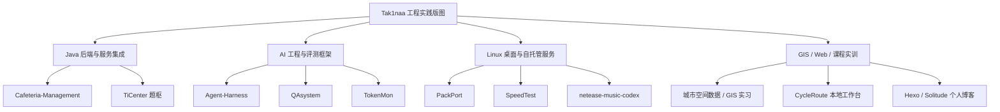
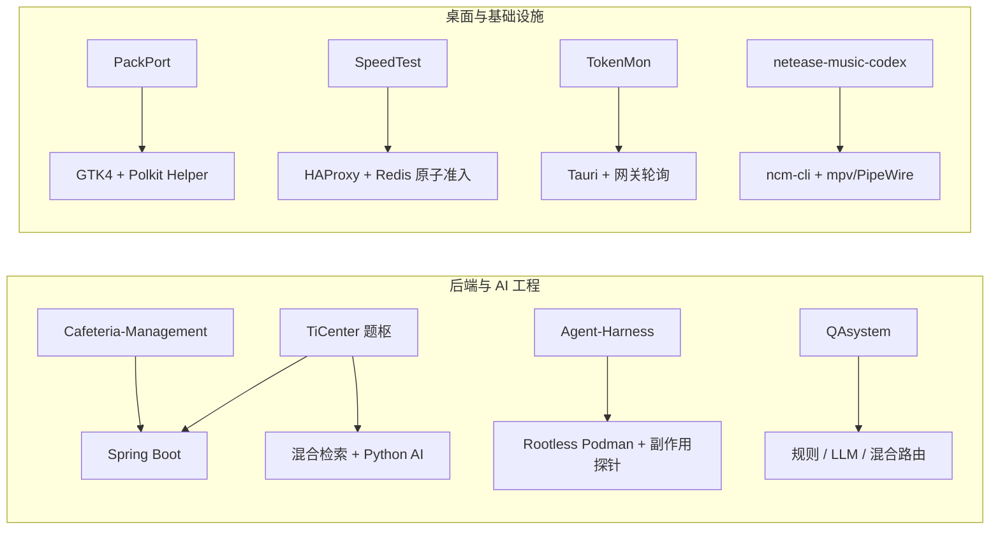

<div align="center">
  <strong>R&amp;D 版本：</strong>
  <a href="./README.zh-CN.md">主简历 中文</a>
  ·
  <a href="./README.md">Main EN</a>
  ·
  <strong>R&amp;D 中文（当前）</strong>
  ·
  <a href="./README.rnd.md">R&amp;D EN</a>
</div>

<br>

<div align="center">
  <h1>
    立立子 · Tak1naa
  </h1>
  <h3>
    系统向 Java 后端开发 • AI 安全评测与基础设施 • Linux 工具工程
  </h3>
  <p>
    契约优先的后端服务 · 隔离容器下的可复现智能体评测 · 实用桌面与自托管工具
  </p>
  <p>
    <b>Java</b> • <b>Spring Boot</b> • <b>Python</b> • TypeScript • Rust (Tauri) • C/C++ • Linux • Podman / Docker
  </p>
</div>

---

<div align="center">
  <h2>System Profile</h2>
</div>

```text
••• booting profile...▸
  [ ◇ ] Identity..........▸ 应子立 / Zili Ying (Tak1naa / Takina)
  [ ◇ ] Affiliation.......▸ 北京交通大学 · 计算机科学与技术（铁路信息技术, 2024–2028）
  [ ◇ ] Primary Focus.....▸ Java 后端开发 · AI 评测与基础设施 · Linux 工具工程
  [ ◇ ] Secondary Track...▸ 城市空间数据 / GIS 工程实践（独立领域方向）
  [ ◇ ] Runtime Stack.....▸ Linux (Fedora / Debian) · Docker Compose · Rootless Podman
  [ ◇ ] Engineering Rule..▸ 默认最小权限 · 可复现验证证据 · 明确项目边界
  [ ✓ ] Blog..............▸ https://tak1na.top/blog
  [ ✓ ] Live SpeedTest....▸ https://tak1na.top/speedtest/
  [ ✓ ] Repositories......▸ https://github.com/Tak1naa?tab=repositories
```

<div align="center">
<a id="top"></a>

<a href="#landscape">技术版图</a> ·
<a href="#experience">经历详情</a> ·
<a href="#stack">技术栈</a> ·
<a href="#matrix">项目矩阵</a> ·
<a href="#focus">近期关注</a> ·
<a href="#telemetry">GitHub 状态</a>

</div>

---

<a id="landscape"></a>

<div align="center">
  <h2>技术版图</h2>
  <p><a href="#top">↑ 返回顶部</a></p>
</div>

<details open>
<summary><strong>◇ 仓库与方向拓扑图</strong></summary>



| 工程方向 | 重点解决的工程问题 | 代表项目 |
| --- | --- | --- |
| **Java 后端与服务集成** | 如何在异构模块、缓存、队列与流式响应间维持清晰契约与可降级路径？ | [Cafeteria-Management](https://github.com/Tak1naa/Cafeteria-Management) · [TiCenter](https://github.com/Tak1naa/TiCenter) |
| **AI 工程与评测脚手架** | 如何在受控预算与容器隔离下，分别验证工程链路可靠性与模型产出效果？ | [Agent-Harness](https://github.com/Tak1naa/Agent-Harness) · [QAsystem](https://github.com/Tak1naa/QAsystem) · [TokenMon](https://github.com/Tak1naa/Tokenmon) |
| **Linux 与自托管工具** | 如何在桌面与公网边缘服务中落实权限分离、原子限流与资源释放边界？ | [PackPort](https://github.com/Tak1naa/PackPort) · [SpeedTest](https://github.com/Tak1naa/SpeedTest) · [netease-music-codex](https://github.com/Tak1naa/netease-music-codex) |
| **GIS / Web / 系统实训** | 如何规范化完成空间/轨迹/前端增强链路，并与核心 Java 后端证据清晰区分？ | 空间数据实习 · CycleRoute · [blog](https://github.com/Tak1naa/blog) |

</details>

---

<a id="experience"></a>

<div align="center">
  <h2>经历与研发实践</h2>
  <p><a href="#top">↑ 返回顶部</a></p>
</div>

<details>
<summary><strong>◇ 展开详细时间线（实习 · 大创科研 · 实训）</strong></summary>

#### **北京城建交通设计研究院有限公司** *（2026.07 – 2026.10，协议期限）*
*研发实习生 — 城市空间数据与 GIS 工程*

- 参与城市空间数据处理，完成多源人口网格、地图与建筑数据的清洗、坐标统一、空间关联与质量检查。
- 参与人口网格标准化、街道尺度汇总，以及卫星影像处理与建筑信息融合；严格执行业务地点与原始数据脱敏规范。
- *口径说明：* 作为独立的应用实践方向呈现，不与 Java 后端工程证据混淆。

---

#### **大学生创新项目 — Agent-Harness** *（2026）*
*研究与工程原型*

- 研究在相同模型、工具集合与调用预算约束下，Bandit 静态告警与 AST 函数上下文是否能提升 LLM 生成 Python 安全测试的有效性。
- 构建受限 `pytest` / `Hypothesis` 生成、rootless Podman 隔离运行、真实副作用探针（路径穿越、命令注入、SQL 注入），配套 CLI、MCP stdio 与浏览器会话客户端。
- 已完成 30 组人工构造配对样本的工程验证，以及 216 次冻结对照试验（A: 62/72、B: 63/72、C: 68/72；排除超上限块后为 61/69、62/69、67/69），工程验证与小样本描述统计分别报告。

---

#### **软件工程实训与专业实践** *（2026）*
*北京交通大学*

- **Cafeteria-Management：** 以 Spring Boot 衔接 C++ 仿真核心（HTTP JSON）与 WebSocket 前端，打通 MySQL、Redis、RabbitMQ 与 DeepSeek/规则引擎降级路径。
- **QAsystem：** 动车检修问答理解与路由原型，输出 8 类问题与 6 类实体的结构化 JSON 路由结果，支持离线 `pytest` 验收。
- **系统综合实训：** 完成 RISC-V SoC 功能调试与 RTL 仿真实验（`NEMU`、`Verilator`、`Vivado`）。

</details>

---

<a id="stack"></a>

<div align="center">
  <h2>技术栈</h2>
  <p><a href="#top">↑ 返回顶部</a></p>
</div>

<details>
<summary><strong>◇ 展开技术栈徽章与分类</strong></summary>

<p align="center">
  
  
  
  
  
  
  
  
</p>
<p align="center">
  
  
  
  
  
  
  
  
</p>

- **后端与契约：** Java, Spring Boot, HTTP/JSON REST, WebSocket, SSE, Flyway
- **数据与消息：** MySQL, PostgreSQL, Redis, RabbitMQ, Qdrant
- **AI 与程序分析：** Python, Bandit, AST 解析, `pytest`, `Hypothesis`, MCP stdio, BM25 + 向量 RRF 融合
- **桌面与前端：** TypeScript, React, GTK4 / Libadwaita, Tauri / Rust, Streamlit, Hexo / Solitude
- **系统与安全加固：** Linux (Fedora / Debian), Docker Compose, rootless Podman, HAProxy, nginx, Polkit

</details>

---

<a id="matrix"></a>

<div align="center">
  <h2>项目矩阵</h2>
  <p><a href="#top">↑ 返回顶部</a></p>
</div>

<details open>
<summary><strong>◇ 完整 R&amp;D 项目目录 <b>(10)</b></strong></summary>



<table>
  <thead>
    <tr>
      <th>⌁ 项目</th>
      <th>⌁ 架构实现与边界说明</th>
      <th>⌁ 技术栈</th>
    </tr>
  </thead>
  <tbody>
    <tr>
      <td><a href="https://github.com/Tak1naa/Cafeteria-Management">Cafeteria-Management</a></td>
      <td>Spring Boot 编排层连接 C++ 仿真内核（HTTP JSON）与 WebSocket 客户端；整合 MySQL、Redis、RabbitMQ 及 DeepSeek/规则引擎降级路径。</td>
      <td><code>Java · Spring Boot · C++ · MySQL · Redis · RabbitMQ</code></td>
    </tr>
    <tr>
      <td><a href="https://github.com/Tak1naa/TiCenter">TiCenter（题枢）</a></td>
      <td>文件优先 AI 题库工作台（学生端/管理端），支持选区上下文、BM25+向量 RRF 检索与 SSE 引用回跳。<i>状态：暂停快照；OCR/Qdrant 迁移与跨服务验收待完成。</i></td>
      <td><code>Java · Spring Boot · React · TS · Python · Qdrant</code></td>
    </tr>
    <tr>
      <td><a href="https://github.com/Tak1naa/Agent-Harness">Agent-Harness</a></td>
      <td>结合 Bandit 与 AST 上下文的 LLM 安全测试研究原型，在 rootless Podman 中执行受限 pytest/Hypothesis 探针，提供 CLI、MCP stdio 与浏览器会话客户端。</td>
      <td><code>Python · Bandit · AST · pytest · Podman · MCP</code></td>
    </tr>
    <tr>
      <td><a href="https://github.com/Tak1naa/PackPort">PackPort</a></td>
      <td>面向 Fedora 的 GTK4/Libadwaita 拖放安装器，支持 RPM、DEB（Alien 转换 + DNF 依赖校验）、AppImage 与 Flatpak，UI 与受限 Polkit helper 权限分离。</td>
      <td><code>Python · GTK4 · Libadwaita · Polkit · DNF</code></td>
    </tr>
    <tr>
      <td><a href="https://github.com/Tak1naa/SpeedTest">SpeedTest</a></td>
      <td>基于 LibreSpeed/bg6cq 的双语测速站，具备 HAProxy HTTPS 入口、Redis 原子并发/滑动窗口限流、有界上传、无遥测及主动可撤回脱敏排行。</td>
      <td><code>PHP · Redis · HAProxy · Docker Compose · JS</code></td>
    </tr>
    <tr>
      <td><a href="https://github.com/Tak1naa/Tokenmon">TokenMon</a></td>
      <td>Tauri/Rust 桌面宠物式模型网关监控器（支持 LiteLLM、OpenRouter、DeepSeek 与自定义 JSON），附带 Python 诊断 CLI；只读轮询零模型消耗。</td>
      <td><code>Rust · Tauri · TypeScript · Python</code></td>
    </tr>
    <tr>
      <td><a href="https://github.com/Tak1naa/QAsystem">QAsystem</a></td>
      <td>动车检修问答意图与实体分析原型，在规则、LLM 与混合模式下输出统一 JSON 路由结果，并支持自动规则回退与离线 pytest 测试。</td>
      <td><code>Python · Streamlit · pytest · DeepSeek API</code></td>
    </tr>
    <tr>
      <td><a href="https://github.com/Tak1naa/netease-music-codex">netease-music-codex</a></td>
      <td>面向 Codex 的网易云音乐 skill，封装 <code>ncm-cli</code> 与 Linux 桌面 <code>mpv</code> + PipeWire/PulseAudio 播放及状态校验。</td>
      <td><code>Skill · ncm-cli · mpv · PipeWire</code></td>
    </tr>
    <tr>
      <td><a href="https://github.com/Tak1naa/blog">blog</a></td>
      <td>Hexo 7 + Solitude 4 个人博客，独立维护 TypeScript 媒体与 PJAX 增强层、按需加载 Live2D 及 Waline + PostgreSQL 自托管评论。</td>
      <td><code>TypeScript · Hexo · Waline · PostgreSQL</code></td>
    </tr>
    <tr>
      <td>CycleRoute <i>（本地项目）</i></td>
      <td>本地维护的隐私优先骑行路书工作台（浏览器端 GPX/TCX/FIT/KML/GeoJSON 解析、WGS84/GCJ-02 转换、BRouter/高德地图、可选 AES-GCM 分享）。</td>
      <td><code>Spring Boot · React · BRouter · AMap · WebCrypto</code></td>
    </tr>
  </tbody>
</table>

</details>

---

<a id="focus"></a>

<div align="center">
  <h2>近期关注</h2>
  <p><a href="#top">↑ 返回顶部</a></p>
</div>

- [ ◇ ] Java / Spring Boot 后端工程与跨服务契约设计
- [ ◇ ] 可复现 AI 评测脚手架、MCP 工具链与沙箱安全验证
- [ ◇ ] Linux 桌面实用工具（GTK4 / Tauri）与容器化自托管服务加固
- [ ◇ ] 坚持验证留痕与边界透明的工程交付习惯

---

<a id="telemetry"></a>

<div align="center">
  <h2>GitHub 状态</h2>
  <p><a href="#top">↑ 返回顶部</a></p>
</div>

<p align="center">
  <a href="https://github.com/Tak1naa">
    
  </a>
  &nbsp;
  <a href="https://github.com/Tak1naa?tab=repositories">
    
  </a>
  &nbsp;
  <a href="https://tak1na.top/blog">
    
  </a>
  &nbsp;
  <a href="https://tak1na.top/speedtest/">
    
  </a>
</p>

<div align="center">
  
</div>

> 2026 · 应子立 (Tak1naa)
